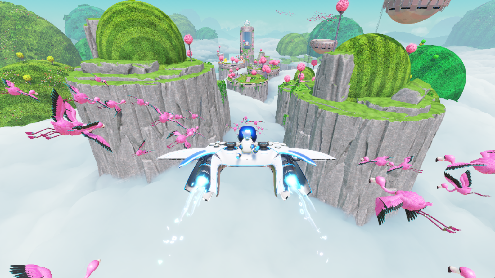
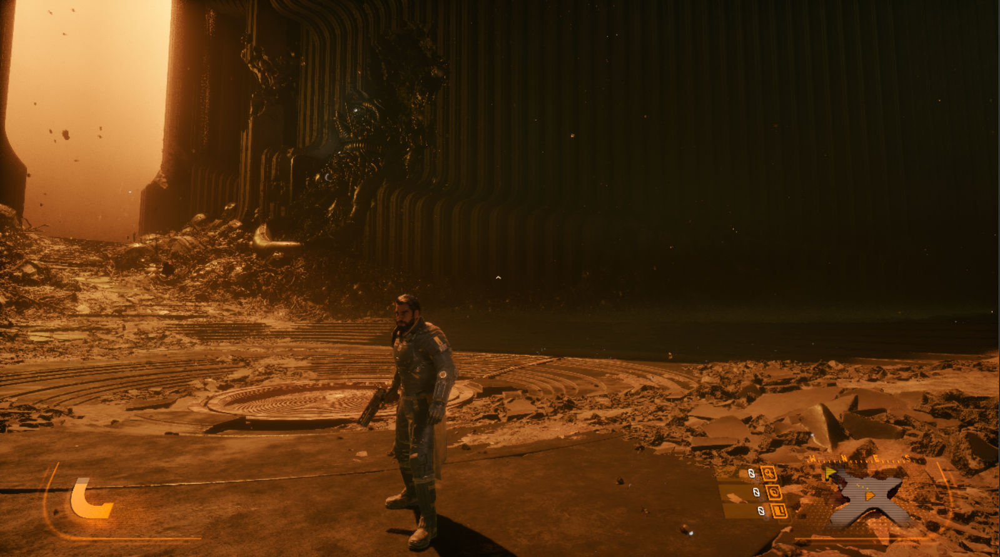
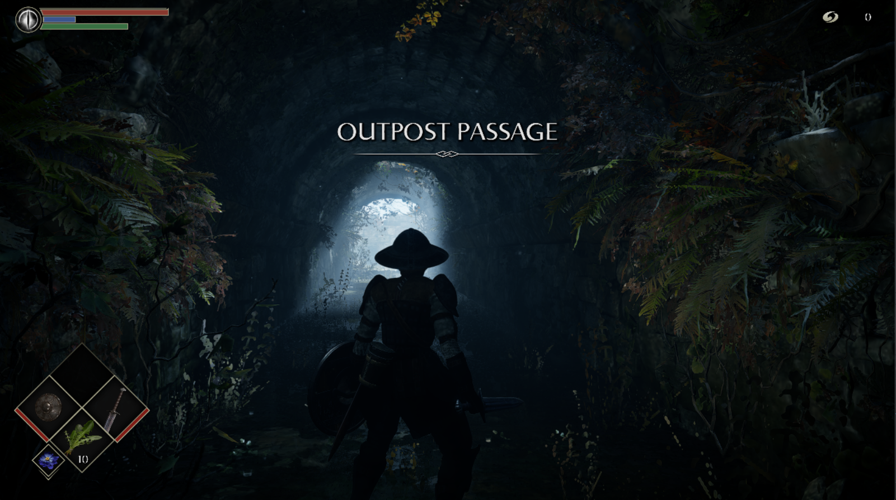
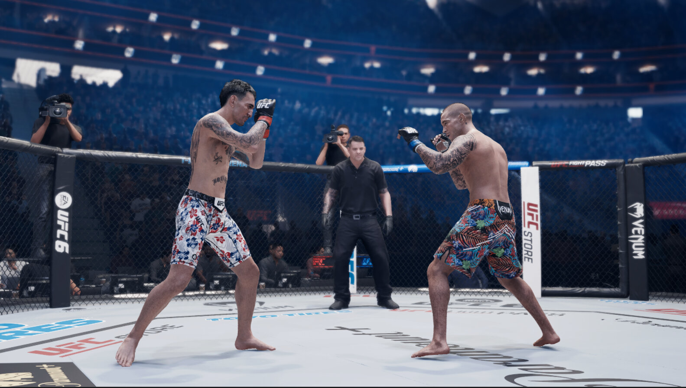

# KytyPS5 — Experimental Compatibility & Diagnostics Fork

> **Fork note:** this is an experimental fork of [KytyPS5/KytyPS5](https://github.com/KytyPS5/KytyPS5)
> (`upstream`). It regularly merges upstream `main` while adding local
> compatibility testing, diagnostics, and launcher improvements. This fork's
> goal is to make more titles boot and progress reliably, record reproducible
> per-title results, and turn rendering or stability regressions into actionable
> fixes. Compatibility is still experimental; a title reaching gameplay does
> not mean it is stable or fully playable. Results below apply only to this fork
> and the test platform described under [Test Platform](#test-platform).


## Changes in This Fork

Relative to upstream `main`:

- **Skip gracefully instead of aborting.** Where upstream hits an
  unrecoverable path, this fork keeps the game running where it is safe to do
  so: draws/dispatches with unmaterializable shader resources, failed pipeline
  creations, unresolvable texture overlaps (equal-address images), and
  unrepresentable stencil state are skipped with a log message.
- **Per-game status and notes in the launcher.** Statuses and comments can be
  set per title ID and are merged on save, so local notes persist across
  remote compatibility-database refreshes instead of being overwritten.
- **File-driven compute-shader skip list.** A `skip_cs_hashes.txt` file next
  to the executable lists shader hashes (one per line, or separated by
  spaces/commas) whose dispatches are skipped. Used to work around
  known-hanging compute kernels during triage.
- **Identifiable builds.** The window title and logs include the short git
  hash of the build, so test results can be tied to an exact commit.
- **AMD / RX580-class compatibility.** Enables primitive-topology list restart
  via `VK_EXT_primitive_topology_list_restart` where supported, and falls back
  to `General` image layout when a depth feedback loop is unsupported.
  Strips/fans are expanded for barycentric draws on AMD.
- **Shader decoder additions.** Implements VOPC `0xbb` (`V_CMPX_LE_U16`) and
  accepts clamp/output-modifier on `V_MIN3`/`V_MAX3`/`V_MED3_F16`, with
  regression tests.
- **Triage logging.** Per-dispatch shader hashes, indirect-dispatch counts,
  subgroup caps, VMA heap budgets, and GPU-assisted validation options to
  diagnose hangs and device-memory pressure.

Upstream merges are pulled in regularly; local commits sit on top.

### Fork goals

- Keep the fork close to upstream while carrying focused, reviewable fixes.
- Test a broad local game set and publish the exact observed state, including
  crashes, missing graphics, visual artifacts, and performance limitations.
- Improve compatibility and diagnostics without implying that booting or
  reaching gameplay equals a finished or fully playable experience.

## About KytyPS5

KytyPS5 is a free and open-source PlayStation 5 emulator written in C++ for
Windows and Linux, with experimental macOS support. It is based on a heavily
modified version of [Kyty](https://github.com/InoriRus/Kyty). The project is in
active development, and behavior can change significantly between builds.

> [!IMPORTANT]
> KytyPS5 is not affiliated with Sony Interactive Entertainment or PlayStation.
> The project does not distribute games or copyrighted system software. Use
> only game files that you have obtained legally.

KytyPS5 can boot 2D games and a selection of 3D games, including titles built
with Unreal Engine 4/5, Unity, and custom engines. External low-level emulation
modules are neither required nor planned. Windows and Linux are the primary
platforms and receive the most testing.

Community test results for upstream builds are in the
[KytyPS5 Compatibility List](https://kytyps5.github.io/). Results measured with
this fork on the test platform below follow in the next section.

## Test Platform

All results in the compatibility table were measured on:

- OS: Windows 10/11 x64
- CPU: Intel Core i7-5820K
- GPU: Radeon RX 580 4GB (amdvlk driver)
- RAM: 16GB

Note: the RX 580 does not support mesh shaders, so titles that require
mesh-shader pipelines are hardware-blocked on this platform regardless of
emulator progress.

## Compatibility (Best Recorded Results and 2026-10-29 Retest)

Best recorded results preserve earlier progress; the latest test is shown separately. A prior result is not claimed as reproduced by the 2026-10-29 retest. Gameplay means a gameplay scene was visible; controls and full playability may remain unverified. If game files were missing or still archived, the result is Not tested. See the [full test notes](docs/notes/game-compatibility-check-2026-10-29.md) for evidence.

| Game | Title ID | Best recorded result | 2026-10-29 test |
| --- | --- | --- | --- |
| A Plague Tale - Innocence | PPSA02388 | Title/logo (2026-10-29) | Slot screen only; no menu (2026-10-29). |
| Alan Wake Remastered | PPSA01925 | Gameplay (2026-10-29) | Gameplay scene; controls confirmed; low FPS (2026-10-29). |
| Alone in the Dark | — | Not tested | Not tested; game files missing (2026-10-29). |
| Avatar - The Last Airbender (USA) | — | Not tested | Not tested; game files missing (2026-10-29). |
| Avatar The Last Airbender - Quest for Balance | PPSA04341 | Main menu (2026-10-29) | Main menu; crashes on Continue (2026-10-29). |
| Away - The Survival Series | PPSA04555 | Title/logo (2026-10-29) | Title/logo only (2026-10-29). |
| Back 4 Blood | PPSA01695 | Title/logo (2026-10-29) | Title/logo only (2026-10-29). |
| Beyond a Steel Sky | PPSA03979 | Title/logo (2026-10-29) | Title/logo only (2026-10-29). |
| Borderlands 3 | PPSA01462 | Title/logo (2026-10-29) | Title/logo only (2026-10-29). |
| Call of the Sea | PPSA01546 | Main menu (prior: 2026-10-02) | Title/logo only (2026-10-29). |
| Chernobylite | PPSA04747 | Main menu (prior: 2026-10-02) | Title/logo only (2026-10-29). |
| Resident Evil 8 - Maiden Demo | PPSA01859 | Main menu (prior: 2026-10-02) | No title/menu visible (2026-10-29). |
| Control Ultimate Edition | PPSA01949 | Gameplay (prior: 2026-10-02) | Title/logo only (2026-10-29). |
| DIRT5 | PPSA01552 | No title/menu (2026-10-29) | No title/menu visible (2026-10-29). |
| Fishing: North Atlantic Enhanced Edition | PPSA02985 | Title/logo (2026-10-29) | Title/logo only (2026-10-29). |
| Five Nights at Freddy's: Security Breach | PPSA04677 | Main menu (prior: 2026-10-02) | No title/menu visible (2026-10-29). |
| Five Nights at Freddy's: Help Wanted 2 | PPSA18887 | No title/menu (2026-10-29) | No title/menu visible (2026-10-29). |
| Ghost of Tsushima | PPSA03208 | No title/menu (2026-10-29) | No title/menu visible (2026-10-29). |
| Ghostrunner | PPSA03682 | No title/menu (2026-10-29) | No title/menu visible (2026-10-29). |
| Grand Theft Auto III - The Definitive Edition | PPSA03527 | Gameplay (2026-10-29) | Gameplay scene; vehicle interaction confirmed (2026-10-29). |
| Grand Theft Auto: San Andreas - The Definitive Edition | PPSA03524 | Gameplay (prior: 2026-10-21) | Main menu; gameplay not verified (2026-10-29). |
| Grand Theft Auto: Vice City - The Definitive Edition | PPSA03530 | Gameplay (prior: 2026-10-21) | New game started; dark scene, controls unconfirmed (2026-10-29). |
| Ghostwire: Tokyo | PPSA01337 | Main menu (2026-10-29) | Main menu; gameplay not verified (2026-10-29). |
| Hot Wheels Unleashed | PPSA02325 | Main menu (prior: 2026-10-02) | Title/logo only (2026-10-29). |
| Indiana Jones and The Great Circle | PPSA26786 | Title/logo (prior: 2026-10-05) | Not retested; game files still archived (2026-10-29). |
| It Takes Two | PPSA02343 | Main menu (2026-10-29) | Menu reached; stopped at player selection (2026-10-29). |
| THE KING OF FIGHTERS XV | PPSA02213 | Main menu (2026-10-29) | Menu and VS selection; no match tested (2026-10-29). |
| Jumanji: The Video Game | PPSA03973 | Gameplay (2026-10-29) | Gameplay scene; controls unconfirmed (2026-10-29). |
| LEGO Star Wars: The Skywalker Saga | PPSA01865 | Title/logo (2026-10-29) | Title/logo only (2026-10-29). |
| MADiSON | PPSA07370 | Main menu (2026-10-29) | Menu and difficulty screen; no gameplay (2026-10-29). |
| Maneater | PPSA01862 | Main menu (prior: 2026-10-02) | No title/menu visible (2026-10-29). |
| Martha Is Dead | PPSA02006 | Title/logo (2026-10-29) | Title prompt only (2026-10-29). |
| The Medium | PPSA03717 | Main menu (2026-10-29) | Menu reached; stalled on New Game (2026-10-29). |
| MXGP 2020 - The Official Motocross Videogame | PPSA01646 | Main menu (prior: 2026-10-02) | Title/logo only (2026-10-29). |
| Observer: System Redux | PPSA02118 | Title/logo (prior: 2026-10-02) | No title/menu visible (2026-10-29). |
| Planet Coaster (EU) | PPSA01735 | No title/menu (2026-10-29) | No title/menu visible (2026-10-29). |
| Planet Coaster (US) | PPSA01736 | Main menu (external) | Blocked at error screen; no menu (2026-10-29). |
| Port Royale 4 | PPSA02815 | Gameplay (prior: 2026-10-02) | Main menu; gameplay not verified (2026-10-29). |
| The Matrix Awakens Demo | PPSA05754 | No title/menu (2026-10-29) | No title/menu visible (2026-10-29). |
| Sackboy: A Big Adventure | PPSA01288 | Title/logo (prior: 2026-10-02) | No title/menu visible (2026-10-29). |
| Sifu | PPSA03001 | Title/logo (prior: 2026-10-02) | No title/menu visible (2026-10-29). |
| STAR WARS Jedi: Fallen Order | PPSA02198 | Title/logo (2026-10-29) | Title/logo only (2026-10-29). |
| Terminator: Resistance Enhanced | PPSA02474 | Title/logo (prior: 2026-10-05) | No title/menu visible (2026-10-29). |
| The Riftbreaker | PPSA03753 | No title/menu (2026-10-29) | No title/menu visible (2026-10-29). |
| Tony Hawk's Pro Skater 1 + 2 | PPSA02176 | Main menu (prior: 2026-10-05) | Title/logo only (2026-10-29). |
| Train Sim World 2: Rush Hour | PPSA03944 | Main menu (prior: 2026-10-05) | Title/logo only (2026-10-29). |
| Tropico 6 | PPSA05682 | Title/logo (2026-10-29) | Title/logo only (2026-10-29). |
| Uncharted: Legacy of Thieves Collection | PPSA05389 | No title/menu (2026-10-29) | No title/menu visible (2026-10-29). |
| Werewolf: The Apocalypse - Earthblood | PPSA02113 | Gameplay (prior: 2026-10-05) | Menu reached; loading scene stalled (2026-10-29). |
| WWE 2K22 | PPSA02460 | Gameplay (prior: 2026-10-05) | Main menu; prior gameplay not reproduced (2026-10-29). |
| The Ascent | PPSA02593 | Main menu (2026-10-29) | Menu reached; exited before gameplay (2026-10-29). |
| Red Dead Redemption - PS5 | PPSA99078 | Not tested | Not tested; package not unpacked (2026-10-29). |
| Resident Evil Village | PPSA01556 | Not tested | Not tested; package not unpacked (2026-10-29). |
| RIDE 4 | PPSA01599 | Main menu (prior: 2026-10-02) | Title/logo only (2026-10-29). |
| Teenage Mutant Ninja Turtles: The Cowabunga Collection | PPSA04489 | Gameplay (2026-10-29) | Gameplay scene; controls unconfirmed (2026-10-29). |

<table align="center">
  <tr>
    <td align="center">
      <strong>Cyberpunk 2077</strong><br>
      
    </td>
    <td align="center">
      <strong>MLB The Show 23</strong><br>
      
    </td>
  </tr>
  <tr>
    <td align="center">
      <strong>Astro Bot</strong><br>
      
    </td>
    <td align="center">
      <strong>Saros</strong><br>
      
    </td>
  </tr>
  <tr>
    <td align="center">
      <strong>Neptunia ReVerse</strong><br>
      
    </td>
    <td align="center">
      <strong>SILENT HILL: The Short Message</strong><br>
      
    </td>
  </tr>
  <tr>
    <td align="center">
      <strong>Demon's Souls</strong><br>
      
    </td>
    <td align="center">
      <strong>UFC 6</strong><br>
      
    </td>
  </tr>
</table>


- Windows 10 version 1803, a current Linux distribution, or macOS on Apple
  Silicon
- A 64-bit x86 processor (on macOS, Apple Silicon with Rosetta 2)
- A Vulkan 1.3-capable GPU with current drivers (on macOS, Vulkan is provided
  by the bundled MoltenVK)

## Building

### Windows

Requirements: Git, CMake 3.22.1+, Ninja, Visual Studio 2022 or Build Tools
2022 with the **Desktop development with C++** workload and **C++ Clang tools
for Windows**, Qt 6 for MSVC 2022 64-bit (Concurrent, Network, Widgets), and
`glslangValidator` on `PATH`. The MSVC compiler (`cl.exe`) is not supported;
use `clang-cl`.


### Build requirements (Windows)

- Git
- CMake 3.22.1 or newer
- Ninja
- Visual Studio 2022 or Build Tools 2022 with the **Desktop development with C++** workload and
  **C++ Clang tools for Windows** component
- Qt 6 for MSVC 2022 64-bit, including Concurrent, Network, and Widgets
- [glslang](https://github.com/KhronosGroup/glslang/releases) (`glslang` or `glslangValidator`) on `PATH`
- Python 3 on `PATH`; the bundled SPIRV-Tools runs it at configure time

The Microsoft C++ compiler (`cl.exe`) is not supported; use `clang-cl`.

Open an **x64 Native Tools Command Prompt for Visual Studio 2022** (or the equivalent Developer
PowerShell), change to the repository root, and initialize the dependencies:


```powershell
git submodule update --init --recursive
cmake -S . -B _Build/windows -G Ninja -DCMAKE_BUILD_TYPE=Release -DCMAKE_C_COMPILER=clang-cl -DCMAKE_CXX_COMPILER=clang-cl -DCMAKE_PREFIX_PATH="C:/Qt/6.x.x/msvc2022_64"
cmake --build _Build/windows --target launcher
cmake --install _Build/windows --prefix _Build/windows/install
```

The runnable application lands in `_Build/windows/install`.

### Linux


Install the toolchain and the libraries the bundled SDL3 needs. Without the audio, Wayland and
udev development packages SDL3 quietly configures itself without those backends, and the resulting
build has no working sound and no gamepad hotplug:

```bash
sudo apt-get install --no-install-recommends \
  clang lld ninja-build cmake git glslang-tools python3 pkg-config \
  libgl1-mesa-dev libx11-dev libxcursor-dev libxext-dev libxfixes-dev \
  libxi-dev libxrandr-dev libxss-dev libxtst-dev libxkbcommon-dev \
  libasound2-dev libpulse-dev libudev-dev libdbus-1-dev libwayland-dev wayland-protocols
```

Qt 6 (Concurrent, Network, Widgets) is required for the launcher — either the distribution packages
(`qt6-base-dev`) or an official Qt installation.


```bash
git submodule update --init --recursive
cmake -S . -B _Build/linux -G Ninja -DCMAKE_BUILD_TYPE=Release \
  -DCMAKE_C_COMPILER=clang -DCMAKE_CXX_COMPILER=clang++ \
  -DCMAKE_PREFIX_PATH="$Qt6_DIR"
cmake --build _Build/linux --target launcher --parallel
cmake --install _Build/linux --prefix _Build/linux/install
```

For `kyty_emulator`/`kyty_tests` without Qt, configure a separate directory
with `-DKYTY_BUILD_LAUNCHER=OFF`.

### macOS

Experimental: x86-64 builds run under Rosetta 2 on Apple Silicon (Xcode CLT,
`cmake`, `ninja`, `glslang`, universal Qt 6). Configure with
`-DCMAKE_OSX_ARCHITECTURES=x86_64`, build and install as on Linux; see
upstream docs for the MoltenVK `libMoltenVK.dylib` signing steps.


cmake -S . -B _Build/linux-no-qt -G Ninja -DCMAKE_BUILD_TYPE=Release \
  -DCMAKE_C_COMPILER=clang -DCMAKE_CXX_COMPILER=clang++ \
  -DKYTY_BUILD_LAUNCHER=OFF

cmake --build _Build/linux-no-qt --target kyty_emulator kyty_tests --parallel
```

As on Windows, the MSVC compiler is not used; Clang is required. `cl.exe` is rejected at configure
time.

The CMake source root is the repository root.

### Building on NixOS

A development shell provides Clang, CMake, Ninja, Qt 6, the Vulkan headers, and the SDL3 backend
libraries. Enter it and configure exactly as on other Linux distributions; the shell exports
`CMAKE_PREFIX_PATH` and `QT_PLUGIN_PATH`, so the `-DCMAKE_PREFIX_PATH="$Qt6_DIR"` argument is not
needed:

```bash
nix-shell # or: nix develop
git submodule update --init --recursive

cmake -S . -B _Build/linux -G Ninja -DCMAKE_BUILD_TYPE=Release \
  -DCMAKE_C_COMPILER=clang -DCMAKE_CXX_COMPILER=clang++

cmake --build _Build/linux --target launcher --parallel
cmake --install _Build/linux --prefix _Build/linux/install
```

The configure step downloads the FFmpeg prebuilts and the `xbyak`, `zydis`, `zstd`, and ZArchive
sources, so it needs network access; a fully sandboxed `nix build` would require vendoring those
inputs. A Vulkan 1.3 driver must be available at runtime (on NixOS,
`hardware.graphics.enable = true`).

### Building on Fedora and Fedora Atomic (Bazzite, Bluefin, Silverblue)

On regular Fedora, install dependencies on the host. On Fedora Atomic variants such as Bazzite,
Bluefin and Silverblue, use [Distrobox](https://distrobox.it/) and run the install and build steps
inside the container. Keep the checkout in your home directory so it is shared with the container.
Add `--nvidia` to the create command for hosts using the proprietary NVIDIA driver:

```bash
distrobox create --name kyty-build --image registry.fedoraproject.org/fedora:latest
distrobox enter kyty-build
```

Install the toolchain, Qt 6 and SDL3 dependencies:

```bash
sudo dnf install -y \
  clang lld ninja-build cmake git glslang python3 pkgconf-pkg-config \
  mesa-libGL-devel libX11-devel libXcursor-devel libXext-devel libXfixes-devel \
  libXi-devel libXrandr-devel libXScrnSaver-devel libXtst-devel libxkbcommon-devel \
  alsa-lib-devel pulseaudio-libs-devel systemd-devel dbus-devel \
  wayland-devel wayland-protocols-devel qt6-qtbase-devel
```

From the repository root, follow the launcher configure, build and install steps in
[Building on Linux](#building-on-linux), omitting `-DCMAKE_PREFIX_PATH="$Qt6_DIR"`; CMake finds
Fedora's packaged Qt 6 automatically.

Run `./_Build/linux/install/kyty_launcher` on regular Fedora or inside the container. To launch a
container build from the host, leave the container with `exit`, then run from the repository root:

```bash
distrobox enter kyty-build -- ./_Build/linux/install/kyty_launcher
```

Qt libraries and plugins are bundled. You can also launch directly on a Fedora Atomic host
if its other system libraries are compatible with the container build.

### Building on macOS

macOS builds target x86-64 and run under Rosetta 2 on Apple Silicon, so the PS5's x86-64 game
code executes through the same translation layer as the emulator itself. Prebuilt archives are
attached to releases; the steps below are for building from source.

Requirements:

- An Apple Silicon Mac with Rosetta 2 installed (`softwareupdate --install-rosetta`)
- Xcode (or the Command Line Tools)
- Homebrew packages: `brew install cmake ninja glslang python`
- Qt 6 (Concurrent, Network, Widgets) with x86-64 support. The official Qt installation is
  universal and works; Homebrew's Qt is arm64-only and will not link

```bash
git submodule update --init --recursive

cmake -S . -B _Build/macos -G Ninja -DCMAKE_BUILD_TYPE=Release \
  -DCMAKE_OSX_ARCHITECTURES=x86_64 \
  -DCMAKE_C_COMPILER=clang -DCMAKE_CXX_COMPILER=clang++ \
  -DCMAKE_PREFIX_PATH="$Qt6_DIR"

cmake --build _Build/macos --target launcher --parallel
cmake --install _Build/macos --prefix _Build/macos/install
```

The build re-signs `kyty_emulator` with the JIT entitlements it needs to execute translated
guest code; no manual signing step is required. When the launcher is built, the install
also produces `_Build/macos/install/KytyPS5.app` — double-click to launch the GUI.
A flat `kyty_emulator` is kept for CLI usage.

Vulkan comes from MoltenVK. Download `MoltenVK-macos.tar` from the
[MoltenVK releases](https://github.com/KhronosGroup/MoltenVK/releases), then copy
`MoltenVK/dynamic/dylib/macOS/libMoltenVK.dylib` next to the flat `kyty_emulator`
(and, for the bundle, into `KytyPS5.app/Contents/Frameworks/`) and ad-hoc sign it:

```bash
codesign --force --sign - _Build/macos/install/libMoltenVK.dylib
# For the bundle (if present):
codesign --force --sign - _Build/macos/install/KytyPS5.app/Contents/Frameworks/libMoltenVK.dylib
codesign --force --sign - _Build/macos/install/KytyPS5.app
```

Release archives already include a signed `libMoltenVK.dylib` (both flat and inside the bundle).

### Regression tests

Build every regression executable and run the registered tests with:


```powershell
cmake --build _Build/windows --target kyty_tests
ctest --test-dir _Build/windows --output-on-failure
```

Use `_Build/linux` instead of `_Build/windows` for a Linux build.

### Visual Studio Code

A ready-made Visual Studio Code setup is included in [`.vscode`](.vscode). It configures CMake
Tools to build the project with Ninja and `clang-cl` and provides launch profiles for both
`kyty_launcher.exe` and `kyty_emulator.exe`. It is Windows-only: VS Code settings cannot select a
compiler per platform, so on Linux configure from the command line as shown above.

Before using it:

1. Install the **CMake Tools** and **C/C++** extensions in Visual Studio Code.
2. Update `CMAKE_PREFIX_PATH` in [`.vscode/settings.json`](.vscode/settings.json) to point to your
   Qt 6 MSVC installation.
3. Update the `--game` path in [`.vscode/launch.json`](.vscode/launch.json) for the
   **Debug kyty_emulator** profile.
4. Open the repository in an x64 Visual Studio developer environment, configure the CMake project,
   and select a launch profile from **Run and Debug**.

## Running

Update the graphics driver before reporting rendering problems. Launch the GUI:

```powershell
.\_Build\windows\install\kyty_launcher.exe
```

```bash
./_Build/linux/install/kyty_launcher
```

On first launch, add game folders in the global settings. The launcher searches
them recursively for game directories containing `eboot.bin` and read-only
ZArchive (`.zar`) dumps, which are streamed without extraction. Or start the
emulator directly:

```powershell
.\_Build\windows\install\kyty_emulator.exe --game "D:\Games\ExampleGame"
```

```bash
./_Build/linux/install/kyty_emulator --game "/games/ExampleGame"
```

Run `kyty_emulator --help` for graphics, logging, validation, profiling, and
debugging options, including the GPU-assisted validation option added in this
fork.

## Contributing

Testing games and submitting detailed bug reports are useful contributions.
Search existing issues first, then use the **Game Emulation Status Report**
template and attach the complete log file. Include the short-hash build label
from the window title or log when reporting against this fork.

Code contributions should be focused, build on the platforms they touch, and
include tests where practical. Set up the clang-format pre-commit hook after
cloning: `python -m pip install pre-commit`, then
`python -m pre_commit install --install-hooks`.

## License

KytyPS5 is licensed under the [GNU General Public License version
2](LICENSE) (`GPL-2.0-only`). It is based on [Kyty](https://github.com/InoriRus/Kyty)
(MIT); the original notice is preserved in [`LICENSES/Kyty-MIT.txt`](LICENSES/Kyty-MIT.txt).
Third-party components keep their own licenses.

## Special Thanks

- [InoriRus/Kyty](https://github.com/InoriRus/Kyty) — the project KytyPS5 is based on.
- [shadps4-emu/shadPS4](https://github.com/shadps4-emu/shadPS4) — reference for PS4
  memory behavior, GPU resource aliasing/cache coherency, and AVPlayer.
